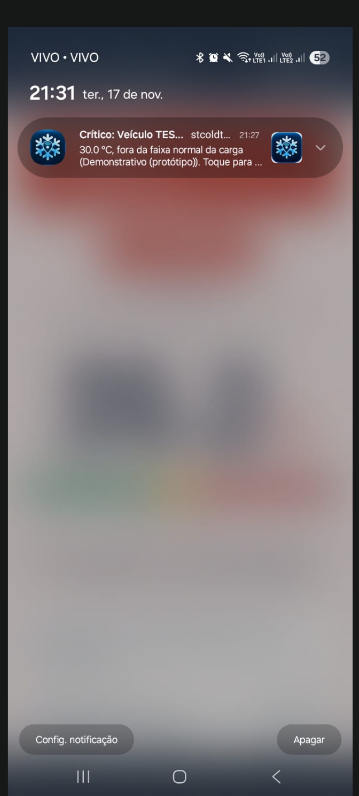
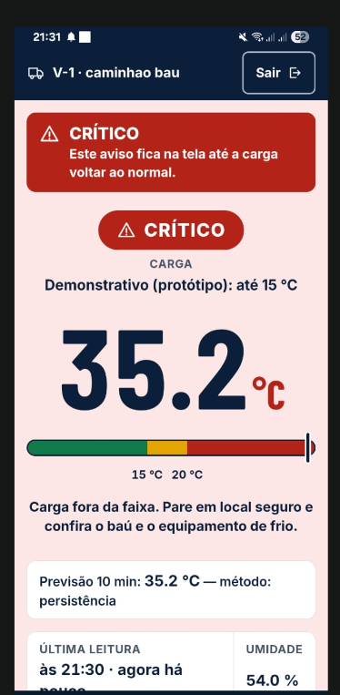

# Relatório de testes: ColdTrack Control

| | |
|---|---|
| Data da execução | 08/11/2026 |
| Versão testada | branch `everson`, commit `5e91187` (site publicado) |
| Site | `https://stcoldtrackweb7319.z15.web.core.windows.net` |
| API | `https://func-coldtrack-7319.azurewebsites.net/api` (Azure Function + Cosmos DB, produção) |
| Empresa usada | `coldtrack` (demonstração), contas gestor e operador |
| Máquina | Windows 10 Pro, Node.js 24.15.0 |
| Ferramentas | Vitest 2.1.9 (jsdom), Playwright 1.64.1 (Chromium) |

## Resumo

| Suíte | Comando | Resultado |
|---|---|---|
| Lint | `npm run lint` | sem avisos |
| Unitários | `npm test` | 158 passaram, 0 falharam (reexecutado em 08/11/2026 depois da revisão da documentação). Em 16/11/2026, com os testes de componente (incluindo Home e ChatWidget): 424 passaram (veja "Cobertura dos testes unitários") |
| Build | `npm run build` | ok |
| E2E simulado (API simulada, build local) | `npm run test:e2e` | 206 passaram, 0 falharam, 18 pulados (os casos de 390 px e de impressão rodam só no projeto desktop, de propósito). Na execução completa, QA-ASSIST-10 (390 px) falhou uma vez, com a máquina sob carga, e passou ao ser repetido sozinho |
| E2E real (site publicado + API de produção) | `npm run test:e2e:real` | 57 passaram, 0 falharam, 0 pulados (site publicado no commit `4d51edd`, chat com Azure OpenAI incluído) |
| E2E real do chat (build local + API de produção) | `REAL-PUB-04`, `05` e `09`, veja abaixo | 3 passaram, 0 falharam (2 perguntas de verdade à rota `/chat`) |

**Reexecução em 17/11/2026** na `main` (commit `faa598b`, com redesign, tela do motorista, alertas
push e exclusão de empresa), na mesma máquina: lint sem avisos; 615 testes unitários em 66
arquivos, 0 falhas; cobertura de 99,19% de linhas e instruções, 95,15% de ramos e 98,84% de
funções; build ok; e2e simulado com 295 passando, 0 falhando e 19 pulados (dois projetos, desktop
e celular). O site publicado serve o mesmo build (`index-Bv_irH8p.js`) e as telas públicas e as
do painel, com a API simulada, abriram sem erro de console. A suíte real contra produção não foi
repetida nesta data.

Lint, unitários, build e e2e simulado foram repetidos depois da ligação do chat com Azure
OpenAI (branch `everson`, 08/11/2026). A suíte real completa contra o site publicado será
repetida depois da próxima publicação; até lá, os testes do chat rodaram contra o build local
(`npm run preview` em `127.0.0.1:5500`, que o CORS da API aceita) falando com a API de produção.

Depois das execuções, o script de limpeza (`npm run test:e2e:real:limpar`) foi rodado e a API
foi consultada: nenhum veículo, sensor, viagem ou usuário com prefixo `QA-` ficou no banco. Os
cadastros da empresa voltaram ao estado de antes (1 veículo, 1 sensor, 0 viagens, 3 usuários).

## Cenários da suíte real

### Login e sessão

| Caso | Cenário | Resultado |
|---|---|---|
| REAL-AUTH-01 | Login do gestor pela tela, perfil e validade da sessão gravados | passou |
| REAL-AUTH-02 | Login do operador pela tela | passou |
| REAL-AUTH-03 | Sessão continua depois de recarregar; `/login` logado leva ao painel | passou |
| REAL-AUTH-04 | Sair limpa a sessão e as telas logadas voltam a pedir login | passou |
| REAL-AUTH-05 | As 7 telas logadas sem sessão vão para `/login` | passou |
| REAL-AUTH-06 | Token com assinatura adulterada: API responde 401 e a tela volta ao `/login` | passou |
| REAL-AUTH-07 | Sessão vencida volta ao `/login` | passou |

### Parte pública

| Caso | Cenário | Resultado |
|---|---|---|
| REAL-PUB-01 | Home carrega com título; carrossel avança, volta, dá a volta e aceita clique no ponto; sem erro no console | passou |
| REAL-PUB-02 | Cada âncora do menu (Início, Projeto, Diferencial, Quem somos, Contato) leva à seção; link direto `/#contato` | passou |
| REAL-PUB-03 | Menu do celular (390 px) abre, navega e fecha; sem rolagem horizontal | passou |
| REAL-PUB-04 | Chat: pergunta rápida respondida pelo FAQ local (sem chamar a IA); avaliação exige nota e é salva uma vez | passou (build local) |
| REAL-PUB-05 | Chat com Azure OpenAI: pergunta fora do assunto ("receita de bolo") é recusada com indicação do WhatsApp; o link leva a dúvida no texto | passou (build local) |
| REAL-PUB-06 | 15 rotas limpas e as 15 páginas antigas `.html` respondem 200 | passou |
| REAL-PUB-07 | `/login.html` abre o login; `/dashboard.html?veiculo=X` sem sessão vai ao login | passou |
| REAL-PUB-08 | Etiqueta antiga `/dashboard.html?veiculo=X` com sessão abre o painel no veículo | passou |
| REAL-PUB-09 | Chat com Azure OpenAI: pergunta sobre o ColdTrack respondida em português, com a linha "Fontes:" | passou (build local) |

### Contrato da API

| Caso | Cenário | Resultado |
|---|---|---|
| REAL-API-01 | `GET /perfis` responde 200 com `id`, `nome`, `min`, `max`, `margem` | passou |
| REAL-API-02 | Rotas do painel sem token (ou com token inválido) respondem 401 `{"erros": [...]}` | passou |
| REAL-API-03 | `POST /empresas` inválido responde 400 com erro por campo; corpo que não é JSON responde 400 | passou |
| REAL-API-04 | `GET /eu` devolve o usuário da sessão | passou |
| REAL-API-05 | Cadastros inválidos (veículo, sensor, viagem, usuário) respondem 400 com erro por campo | passou |
| REAL-API-06 | `GET /leituras` sem `deviceId` responde 400; sensor de fora responde 404 | passou |
| REAL-CAD-01 | Tela de cadastro de empresa: campos em branco barrados na tela; e-mail e senha inválidos mostram os erros da API, sem criar empresa | passou |

### Cadastros do gestor (ida e volta)

| Caso | Cenário | Resultado |
|---|---|---|
| REAL-GES-01 | Registrar sensor QA: chave mostrada uma vez, some ao recarregar, API não devolve chave nem hash | passou |
| REAL-GES-02 | Cadastrar veículo QA com o perfil `manga` e o sensor QA; aparece na lista e na API | passou |
| REAL-GES-03 | Etiqueta QR: o desenho é exatamente o QR de `/dashboard.html?veiculo=<código>`; o endereço abre o painel no veículo | passou |
| REAL-GES-04 | Registrar viagem do veículo QA, encerrar (fim depois do início) e remover | passou |
| REAL-GES-05 | Gerar nova chave (diferente da primeira); remover sensor em uso é recusado (409) com aviso | passou |
| REAL-GES-06 | Remover o veículo e depois o sensor; os dois somem da API | passou |

### Usuário descartável

| Caso | Cenário | Resultado |
|---|---|---|
| REAL-USR-01 | Gestor cria usuário QA com perfil operador | passou |
| REAL-USR-02 | Gestor redefine a senha do usuário QA | passou |
| REAL-USR-03 | Usuário QA entra num navegador limpo, vê o painel de operador, erra a senha atual (mensagem), troca a senha, segue logado; senha antiga recusada com "e-mail ou senha incorretos"; entra com a nova | passou |
| REAL-USR-04 | Gestor remove o usuário QA; o login dele deixa de valer | passou |

### Operador

| Caso | Cenário | Resultado |
|---|---|---|
| REAL-OPE-01 | As 7 telas abrem para o operador, sem controles de gestor e sem erro no console (7 casos) | passou |
| REAL-OPE-02 | API permite ao operador ler `/eu`, veículos, sensores, viagens e perfis | passou |
| REAL-OPE-03 | API recusa com 403 as 12 ações de gestor feitas com o token do operador | passou |

### Telas do painel em 1280 px e 390 px

| Caso | Cenário | Resultado |
|---|---|---|
| REAL-TEL (14 casos) | Dashboard, Alertas, Relatórios, Veículos, Sensores, Viagens e Configurações em 1280 px e em 390 px: título da aba e da tela, "Azure conectado", sem erro no console, sem rolagem horizontal | passou |
| REAL-TEL-CSV | Relatório baixa o CSV: nome `coldtrack-<veículo>-168h.csv`, BOM, cabeçalho `medido_em;temperatura_c;umidade_pct;rssi_dbm;status`, uma linha por leitura da tabela | passou |

O sensor físico não enviou leituras nos últimos 7 dias, então o Relatório mostrou o estado
vazio. Para conferir o arquivo, o teste repetiu o pedido à API real sem o filtro de período
(as últimas leituras gravadas do sensor). Essa troca fica registrada como anotação no
relatório do Playwright.

## Chat com Azure OpenAI

O campo livre do chat da página inicial chama `POST /chat` (Azure OpenAI, rota pública da API).
Se a rota falha (sem rede, 503, outro erro ou 15 s sem resposta), a pergunta é respondida pelo
FAQ local, com os mesmos textos de antes; 429 mostra o aviso da API. As perguntas rápidas
continuam respondendo pelo FAQ, sem chamar a rota.

| Camada | Casos | O que verifica |
|---|---|---|
| Unitários `src/lib/chat.test.js` | 10 | POST sem token, corpo `{ pergunta, historico? }` (pergunta até 500, últimas 6 mensagens, texto até 1000), 200 com fontes, 400/429/503 com a mensagem da API e o status, erro sem corpo, resposta vazia, falha de rede, tempo limite de 15 s, cancelamento |
| Unitários `ChatWidget/conversa.test.js` | 11 | histórico só com turnos de pergunta e resposta, IA respondendo, FAQ como plano B em 503, 500, 400, rede e tempo esgotado, FAQ sem resposta, 429 sem FAQ |
| E2E simulado QA-CHAT-17 a 25 (x2 projetos) | 9 | resposta como texto (quebras de linha mantidas, HTML não interpretado) com "Fontes:", sem fontes sem a linha, "Digitando..." em região `aria-live="polite"`, botão desabilitado e sem envio duplo, 503 e 15 s sem resposta caem no FAQ, 429 mostra o aviso, histórico enviado (máximo 6 mensagens, sem o manual), perguntas rápidas sem chamar a rota |
| E2E real REAL-PUB-05 e 09 | 2 | rota de verdade pela tela, no máximo 2 perguntas por execução |

Respostas obtidas na execução real (08/11/2026, build local, API de produção):

- *"Como o ColdTrack decide se a temperatura da carga está em atenção?"*: "O ColdTrack
  classifica a temperatura da carga como "Atenção" quando a leitura está fora da faixa normal,
  mas dentro da margem definida no perfil da carga cadastrado na API (GET /perfis). [...]"
  Fontes: painel/README.md, docs/stack-tecnica.md, docs/memorial-descritivo.md.
- *"Me passa uma receita de bolo de chocolate?"*: "Não sei responder sobre receita de bolo de
  chocolate. Para dúvidas sobre o ColdTrack, use o botão Falar com o desenvolvedor (WhatsApp)." A rota devolveu também
  Fontes: docs/stack-tecnica.md, docs/api.md (ver limitações).

Os textos do FAQ que contradiziam o produto atual foram corrigidos: o caminho dos dados é a API
no Azure (Azure Functions e Cosmos DB), não o ThingSpeak (que fica só na tela demonstrativa
Monitoramento), e os limites de temperatura vêm do perfil de carga de cada veículo, não de
valores fixos.

## Assistente do painel (Azure OpenAI, rota autenticada)

Todas as telas logadas têm o botão flutuante **Assistente**, que chama `POST /assistente` com o
token da sessão. Ele responde dúvidas de uso (base: `docs/guia-de-uso.md`) e perguntas sobre os
dados da empresa logada. Lint, unitários, build e e2e simulado rodaram na branch `everson` em
08/11/2026, com a rota simulada. A rota já existe na API de produção (responde 401 sem token).

| Camada | Casos | O que verifica |
|---|---|---|
| Unitários `src/lib/assistente.test.js` | 10 | POST com `Bearer`, corpo `{ pergunta, historico? }` (pergunta até 500, últimas 6 mensagens válidas, texto até 1000), 200 com fontes limpas, 400 e 429 com a mensagem da API, 503 com o aviso de indisponível, 401 limpa a sessão e chama o redirecionamento (igual à `api()`), resposta vazia, falha de rede, tempo limite de 20 s, cancelamento sem marcar tempo esgotado |
| Unitários `AssistentePainel/conversa.test.js` | 6 | pergunta e resposta na conversa, "esperando" liga e desliga, histórico só com perguntas respondidas (máximo 6 mensagens), 429 e 503 viram mensagem, sem envio vazio nem duplo, troca de sessão zera a conversa e descarta a resposta pendente |
| E2E simulado `assistente.spec.js`, QA-ASSIST-01 a 11 | 12 casos, 21 execuções e 3 pulados (09 a 11 só no desktop) | botão nas 7 telas logadas para gestor e operador e em nenhuma das 8 públicas; saudação pelo primeiro nome; sugestão com `Bearer`, resposta em texto puro com quebra de linha e "Fontes:"; "Assistente digitando…" com campo e envio desligados; histórico na segunda pergunta (Enter); conversa mantida ao trocar de tela e apagada ao sair; 429 com o aviso da API; 503 com "O assistente está indisponível agora. Tente de novo em instantes."; Escape e × fecham com o foco de volta no botão; 390 px com o painel aberto na largura toda e sem rolagem horizontal nas 7 telas; botão não cobre o rodapé; impressão esconde o assistente |
| E2E real `08-assistente.spec.js`, REAL-ASSIST-01 | 1 | gestor pergunta "Quantos veículos eu tenho cadastrados?" pela tela e recebe resposta não vazia; uma chamada real por execução; pula com o motivo se o site publicado ainda não tem o botão ou se a rota responde 404/503 |

REAL-ASSIST-01 ainda não foi executado contra produção. Sem as credenciais da suíte real na
máquina, ele é pulado; rode `npm run test:e2e:real` com as credenciais para registrar o resultado.

## Segurança do front (CSP, logout no servidor, mensagem de login)

Medidas descritas na seção 9 do `README.md`. Lint, unitários, build e e2e simulado rodaram na
branch `everson`; a rota `POST /sair` e a mensagem única de login 401 são simuladas, porque o
backend está sendo publicado em paralelo.

| Camada | Casos | O que verifica |
|---|---|---|
| Unitários `ChatWidget/conversa.test.js` | 1 | 429 "o chat atingiu o limite de perguntas de hoje..." cai no FAQ como o 503; o 429 por minuto continua mostrando o aviso da API |
| Unitários `src/lib/api.test.js` (`sairNoServidor`) | 4 | `POST /sair` com `Bearer`; 404, 401 e falha de rede ignorados; sem token não chama a API; aborta no limite de 5 s |
| E2E `painel.spec.js`, QA-SEG-01 e 02 | 4 casos | Sair chama `/sair` uma vez com o `Bearer` da sessão, limpa o `localStorage` e vai ao `/login`; continua saindo com `/sair` em 404, 500 ou com a rede caída |
| E2E `login-erro.spec.js`, QA-SEG-03 a 05 | 3 casos | Tela de login e formulário da Home mostram "e-mail ou senha incorretos. Se errou várias vezes, aguarde alguns minutos." (401) e ainda mostram o aviso do 429 (agora só limite por IP: "muitas tentativas de login erradas. Aguarde alguns minutos.") |
| E2E `painel.spec.js`, QA-SEG-09 | 1 caso | Em Configurações, a linha do próprio gestor mostra só "você" (sem Redefinir senha nem Remover); o operador continua com as duas ações |
| E2E `csp.spec.js`, QA-SEG-06 a 08 | 3 casos | O build traz a CSP e o `referrer` em `<meta>` (sem `unsafe-eval`); as 15 rotas, o chat, o assistente, a etiqueta QR e o download do CSV não geram nenhuma violação ("Refused to") |

O mock de login de `apoio.js` passou a devolver a mensagem nova. `REAL-USR-03` agora confere a
mensagem por trecho ("e-mail ou senha incorretos"), para valer com a API antiga e a nova.

Auditoria de dependências (`npm audit`): a produção tem 2 avisos moderados, em `react-router` e
`react-router-dom` (6.30.6 é a última 6.x; a correção exige React Router 7, migração fora do
escopo). Os demais são só de desenvolvimento (`vite`, `esbuild`, `vitest`, `tinypool`, `vite-node`,
`@vitest/mocker`) e exigem salto de versão maior; não entram no site publicado.

## Cobertura dos testes unitários

Medida com `npm run test:cobertura` (Vitest 2.1.9 com `@vitest/coverage-v8`; testes de componente
com `@testing-library/react` e jsdom), em 16/11/2026, sobre todo o código de `src/` (exceto
arquivos de teste e `main.jsx`). 424 testes unitários passaram.

| Métrica | Antes (29,72%) | Medido agora | Piso no CI |
|---|---|---|---|
| Linhas | 29,72% | 98,99% | 98% |
| Instruções | 29,72% | 98,99% | 98% |
| Ramos | 91,72% | 94,19% | 94% |
| Funções | 84,91% | 98,53% | 98% |

Antes desta etapa, as telas Dashboard, Sensores, Veículos, Viagens, Relatórios, Auditoria,
Usuários, Logística, Monitoramento e Cadastro de usuário, o gráfico, a moldura do painel
(`PainelLayout`), o assistente, a guarda de rota, a sessão e a tabela de rotas estavam em 0% de
linhas. Todos passaram a ter teste de componente com a API, a sessão e a rede simuladas: cada
teste renderiza a tela, interage (digitar, filtrar, enviar formulário, confirmar, fechar diálogo)
e confere o resultado na tela e nas chamadas à API.

`Home` (página inicial pública) e `ChatWidget` (chat público), cerca de 1.100 linhas antes cobertas
só pelo e2e, também têm teste de componente (`Home.test.jsx`, 18 casos; `ChatWidget.test.jsx`,
15 casos), com a API e o `fetch` simulados:

| Tela | Casos cobertos |
|---|---|
| `Home` | seções e título da aba; setas e pontos do carrossel dando a volta nas pontas; avanço automático a cada 6 s e parada com movimento reduzido; menu móvel; âncoras (rolagem suave, sem animação com movimento reduzido, clique com Ctrl, âncora na URL, âncora inexistente); cabeçalho opaco após 50 px; login embutido (campos vazios, só espaços, sucesso com `POST /login` e ida ao dashboard, credencial recusada, recusa sem lista de erros, falha de rede) |
| `ChatWidget` | abrir/fechar com foco, Escape e ×; saudação uma só vez; chips de FAQ respondidos localmente sem chamar a API; campo livre em `POST /chat` com as fontes; histórico da pergunta anterior; falha da rota caindo no FAQ; FAQ sem resposta com aviso do WhatsApp; 429 por minuto (aviso da API) e 429 diário (FAQ); campo vazio; Manual e infográfico (sem duplicar, imagem ausente); resolução Sim/Não; avaliação (sem nota, com nota e comentário, acréscimo às já salvas, armazenamento indisponível); cancelamento do pedido ao sair da tela |

Na medição de 16/11 as telas do motorista ainda não estavam na `main`; na reexecução de 17/11
elas entram na conta (`pages/Motorista` com 100% de linhas e ramos).

Apoio nos testes (`src/testes/setup.js`): o jsdom não tem `<dialog>.showModal()`, `PointerEvent`
nem `AbortSignal.any`, então o arquivo de preparação simula o essencial de cada um (atributo
`open` e evento `close`; `clientX` nos eventos de ponteiro; combinação de sinais de cancelamento).

O piso fica em `test.coverage.thresholds` de `vite.config.js` e o workflow `testes.yml` roda
`npm run test:cobertura`, então o CI falha se a cobertura cair abaixo dele. O piso foi fixado logo
abaixo do valor medido (não é meta). A meta de 60% de linhas da issue foi superada. Restam
61 linhas sem cobertura (de 6.084).

## Estado offline (issue #13)

| Camada | Caso | Resultado |
|---|---|---|
| Unitário `conectividade.test.js` | hora da última recepção, `useOnline` com eventos `online`/`offline` | 4 casos |
| Unitário `FaixaOffline.test.jsx` | online sem faixa; offline com hora; offline sem dado (não inventa hora); some ao voltar | 4 casos |
| Unitário `api.test.js` | `api()` registra a recepção só quando a resposta chega | 2 casos |
| E2E `offline.spec.js`, QA-OFFLINE | `context.setOffline(true)`: faixa com `HH:MM`, indicador "Sem internet", texto >= 15 px, peso >= 600, some ao voltar; faixa presente nas 7 telas logadas | 9 casos, 18 execuções (2 projetos) |

Verificação manual do service worker (build servido por `vite preview`, Chromium, `setOffline`):
depois da primeira visita o cache `coldtrack-v13` guarda 36 arquivos (shell, JS/CSS e pedaços de tela)
e as rotas `/login` e `/cadastro` abrem sem internet. O e2e automático roda com o service worker
bloqueado (`serviceWorkers: "block"`, para a API simulada funcionar), então esta parte não está no CI.

## Defeito encontrado e corrigido

| Onde | Problema | Correção |
|---|---|---|
| Relatórios, estado vazio de 7 dias | O texto saía "Nenhuma leitura **nas** últimos 7 dias." | `src/pages/Relatorios/Relatorios.jsx` usa "nos" para 7 dias e "nas" para 24 h, como a tela de Alertas. Lint, unitários, build e e2e simulado continuam passando. A correção chega ao site na próxima publicação. |

Nenhum outro defeito de funcionamento foi encontrado.

## Alerta push no celular real (issue #11)

Testado em 17/11/2026 num celular Android, com a conta de motorista, o PWA fechado por completo
e sem restrição de bateria para o navegador. A leitura que disparou o alerta veio de um sensor
de teste temporário (`teste-push7`, leituras marcadas como `origem: simulador`), porque a placa
real fica acima de 30 °C no ambiente e o push só sai quando a faixa piora; o sensor de teste foi
removido logo depois. A API registrou "2 de 2 aceitos" às 21:27 e a notificação chegou com o app
fechado. Antes disso nenhum push funcionava em produção: o `VAPID_SUBJECT` tinha um caminho na URL
e a biblioteca recusava a assinatura (corrigido na API, PR #110, que também envia `Urgency: high`).

## Limitações conhecidas

- **Fontes na recusa do chat:** para pergunta fora do assunto, a rota `/chat` recusa
  corretamente, mas ainda devolve `fontes` preenchidas, e o chat mostra a linha "Fontes:". O
  ajuste é na API (devolver `fontes: []` quando recusa).
- **Configuração do sensor pelo cabo USB** (Web Serial, em Sensores) precisa da placa física
  ligada ao computador; não é coberta por teste automático.
- **Telemetria ao vivo** (leitura nova chegando, mudança de status, alerta disparando) precisa
  da placa ligada e enviando. A suíte não grava leituras: elas não podem ser apagadas pela API.

## Como repetir

Instruções, variáveis de ambiente e regras de segurança em `coldtrack-qa/real/README.md`.
